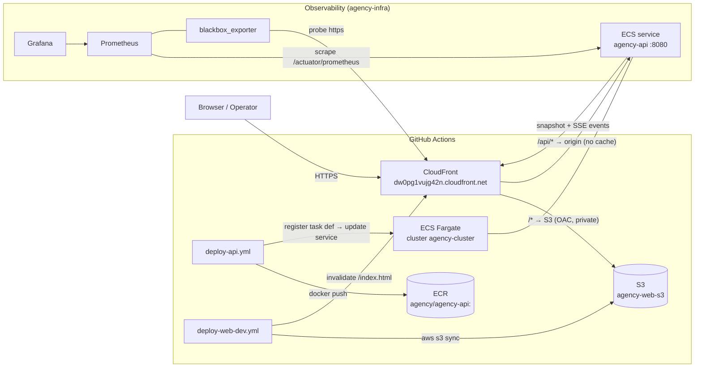
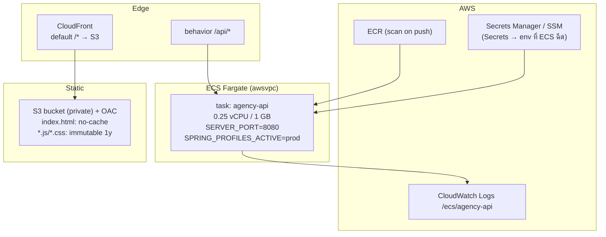
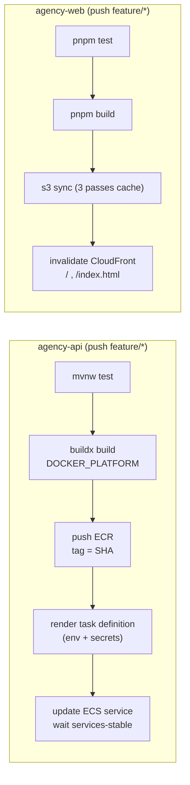

# Agency Dashboard — Architecture

> Diagram สำหรับ draw.io / diagrams.net: [`architecture.drawio`](architecture.drawio) (2 หน้า: Runtime บน AWS, Environments & CI/CD)

> เอกสารนี้สรุปสถาปัตยกรรมของทั้งโปรเจกต์ (web + api + infra + CI/CD)
> ข้อมูล ณ branch `feature/sse` (มี SSE + health + metrics)

## 1. ภาพรวม (Context)



- **ผู้ใช้เห็น origin เดียว** (CloudFront) → เว็บเรียก `/api/...` แบบ relative ไม่ต้องมี CORS
- **SSE วิ่งผ่าน CloudFront behavior `/api/*`** (ปิด cache, ส่ง `Accept` ผ่าน, ไม่บีบอัด)

## 2. Repositories

| repo | หน้าที่ | เทคโนโลยี |
|---|---|---|
| `agency-api` | REST + SSE + mock data + aggregation + metrics | Spring Boot 4.1 / Java 21 / Tomcat 11 |
| `agency-web` | UI, ตาราง 19 คอลัมน์, SSE client, flash, loading/error | Angular 21 (standalone + signals) |
| `agency-docs` | docker stacks (app/infra/pull) + architecture | Docker Compose + Makefile |
| `agency-docs-api` | Bruno collection (contract tests) + decision log | OpenCollection YAML |

## 3. Production topology



| ชั้น | รายละเอียด |
|---|---|
| Edge | CloudFront `E2NZZV53SFAJLJ` — `DefaultRootObject=index.html`, ไม่มี custom error response (SPA fallback ลึก ๆ ยัง 403) |
| Static | S3 `agency-web-s3` + OAC, block public, bucket policy อนุญาตเฉพาะ distribution |
| API | ECS service `agency-api` (cluster `agency-cluster`), public endpoint (`*.ecs.<region>.on.aws`) เป็น origin ของ `/api/*` |
| Image | `ECR agency/agency-api:<commit-sha>` (ไม่มี `latest`) — platform ตาม `DOCKER_PLATFORM` |
| Config | env จาก task definition (+ `APP_ENV_JSON` / `APP_SECRETS_JSON` จาก GitHub Secrets) |

## 4. Runtime flow (SSE)

```mermaid
sequenceDiagram
  autonumber
  participant B as Browser (Angular)
  participant CF as CloudFront
  participant A as agency-api
  B->>CF: GET / (index.html + hashed assets)
  CF->>B: SPA shell
  B->>CF: GET /api/v1/dashboard/stream (Accept: text/event-stream)
  CF->>A: proxy (CachingDisabled, AllViewerExceptHostHeader)
  A-->>B: event: dashboard → snapshot ปัจจุบัน (envelope)
  loop ทุก 20 วินาที
    A-->>B: ": ping" (heartbeat กัน proxy ตัด)
  end
  Note over O as Operator/curl/Bruno
  O->>A: POST /api/v1/dashboard/refresh
  A-->>B: event: dashboard → snapshot ใหม่ (ทุกแท็บพร้อมกัน)
  B->>B: diff ค่าเก่า/ใหม่ → flash เขียว(ขึ้น)/แดง(ลง) 900ms
```

- **snapshot เดียว**: `GET`, SSE, และ response ของ `POST /refresh` เห็นตัวเลขชุดเดียวกัน (เปลี่ยนเมื่อมี refresh เท่านั้น)
- **error**: connection หลุด → banner + คงตารางล่าสุด, EventSource reconnect เอง; ครั้งแรกไม่ติด → fatal + ปุ่ม Retry
- **graceful shutdown**: ปิด SSE emitter ก่อน Tomcat หยุด (`ContextClosedEvent` + `stopTimeout: 30`)

## 5. Environments / stacks

| env | วิธีรัน | web | api | หมายเหตุ |
|---|---|---|---|---|
| Local dev | `pnpm start` + `./mvnw spring-boot:run` | :4200 (proxy) | :8080 | `.env` → `API_HOST` (dev proxy), relative URLs |
| Docker (build) | `make up` (`agency-stack`) | :4200 | :8080 | build จาก source ปัจจุบัน, nginx proxy `/api` |
| Docker (prebuilt) | `make build-versions` → `make pull` (`agency-pull`) | :4201 | :8081 | เดโม `develop` (polling) vs `sse` (SSE) |
| Staging/Prod | GitHub Actions → S3 + ECS | CloudFront | ECS Fargate | feature/* → staging, dispatch → production |
| Observability | `make infra` (`agency-infra`) | — | — | Prometheus :9090, Grafana :3000, blackbox :9115 |

## 6. API contract

Envelope ทุก endpoint:

```json
{ "success": true, "type": "success", "message": "Successful.", "data": { } }
```

| endpoint | คำอธิบาย | develop | feature/sse |
|---|---|:--:|:--:|
| `GET /api/v1/dashboard` | snapshot ปัจจุบัน (develop: สุ่มใหม่ทุกครั้ง) | ✅ | ✅ |
| `POST /api/v1/dashboard/refresh` | สุ่มชุดใหม่ + push ให้ทุก client | ❌ | ✅ |
| `GET /api/v1/dashboard/stream` | SSE event `dashboard` | ❌ | ✅ |
| `GET /api/v1/health` | probe เบา (ไม่ generate data) | ❌ | ✅ |
| `GET /actuator/prometheus` | whitebox metrics | ❌ | ✅ |

Error ก็ใช้ envelope เดียวกัน (`success=false`, `type` เช่น `not_found`, `data=null`) ผ่าน `ApiExceptionHandler`

## 7. Observability

| ชั้น | เก็บอะไร | ที่มา |
|---|---|---|
| **Blackbox** (synthetic) | `probe_success`, `probe_duration_seconds`, `probe_http_status_code`, cert expiry | `blackbox_exporter` → targets ใน `prometheus/targets/blackbox.yml` |
| **Whitebox** (API) | HTTP (`http_server_requests_seconds_*`), JVM heap/GC/threads, Tomcat, CPU | `/actuator/prometheus` (micrometer) |
| **Custom SSE** | `dashboard_stream_subscribers`, `dashboard_stream_events_total`, `dashboard_stream_publish_failures_total`, `dashboard_refresh_total`, `dashboard_snapshot_timestamp_seconds` | `DashboardStream` / `DashboardService` |
| Dashboards | *Blackbox — HTTP probes*, *API — Spring Boot metrics* | Grafana provisioning (`agency-infra/grafana/dashboards`) |
| Alerts | SiteDown / SiteSlow / SiteNotOk / CertExpiringSoon | Prometheus rules (ยังไม่มี Alertmanager ⇒ ไม่มี notification) |

## 8. CI/CD



- Auth: OIDC (แนะนำ) หรือ static keys (fallback) — `AWS_AUTH_MODE`
- Secrets: `AWS_ROLE_ARN` / keys, `APP_ENV_JSON`, `APP_SECRETS_JSON` (ค่า secret จริงควรอยู่ใน Secrets Manager ผ่าน `valueFrom`)
- Cache busting: `index.html` = `no-cache`; `*.js|*.css` = `immutable`

## 9. Security boundaries

- **Secrets**: ไม่อยู่ใน web bundle, ไม่อยู่ใน git, ไม่อยู่ใน image — ECS ฉีดตอน start (Secrets Manager/SSM)
- **S3**: private + OAC, bucket policy ผูก `AWS:SourceArn` ของ distribution
- **Network**: SG ของ task เปิด 8080 จาก ALB SG เท่านั้น
- **Actuator**: ห้ามเปิด public — ALB route เฉพาะ `/api/*`
- **Swagger**: ปิดใน `prod` (`application-prod.yml`)

## 10. Decisions & constraints

| เรื่อง | เหตุผล |
|---|---|
| SSE ไม่ใช่ polling | ข้อมูลเปลี่ยนเมื่อมีคนสั่ง refresh → push ครั้งเดียวถึงทุกแท็บ; heartbeat 20s กัน proxy ตัด |
| snapshot เดียว (AtomicReference) | GET/SSE/refresh ต้องตรงกัน; เดิม GET สุ่มใหม่ทุกครั้งจึงขัดกับ SSE |
| envelope ทุก response | client parse รูปเดียว, error มี type/message |
| flash จาก diff ฝั่ง client | server ส่ง snapshot เต็ม; client เทียบช่องต่อช่อง → กระพริบเฉพาะที่เปลี่ยน |
| port 8080 | ตรงกับ Dockerfile / ALB target group / nginx (แทนที่ 8081 ที่ค้างใน config เก่า) |
| tag image = SHA ไม่มี latest | กัน staging/prod ทับกัน, rollback ด้วย revision |

## 11. Gaps / next steps

1. **Alertmanager** — ให้ alert 4 ตัวส่ง notification (ตอนนี้เห็นแค่ใน Prometheus/Grafana)
2. **CloudWatch exporter** — CloudFront requests / 4xx / 5xx / cache hit ratio ของ prod
3. **SPA fallback** — ตอนนี้ deep link (`/dashboard`) ได้ 403; ใช้ CloudFront Function rewrite แทน custom error response (ที่เคยกลืน error ของ API)
4. **Web image สำหรับ CI** — `agency-pull` ใช้ image ที่ build ในเครื่อง (จาก git ref) แต่ถ้าอยากให้ดึงจาก registry ต้องเพิ่ม step build+push ของ web (ตอนนี้ deploy ผ่าน S3 เท่านั้น)
5. **ข้อมูลจริง** — เปลี่ยน `DashboardGenerator` เป็น query (DB/DWH) + ETag/cache
6. **Health endpoint สำหรับ ALB** — ใช้ `/api/v1/health` แล้ว แต่ยังไม่มี readiness ถึง DB (ยังไม่มี DB)
